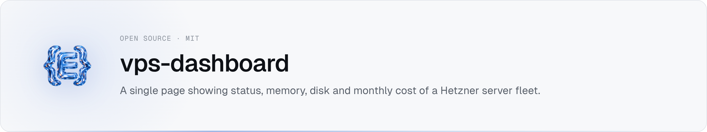

<picture><source media="(prefers-color-scheme: dark)" srcset="assets/banner-dark.png"></picture>

A single, minimal page to see all your Hetzner VPS at a glance: online/offline,
RAM used/total, disk used/total, monthly price, and a ready-to-copy SSH command.
Not a monitoring tool — no graphs, no history, no CPU breakdown, no logs.

Stack: Next.js 16 (App Router) + TypeScript + Tailwind CSS + SQLite
(`better-sqlite3`) + the Hetzner Cloud API, deployed with Docker. A tiny
zero-dependency Node.js agent runs on each VPS to report live RAM/disk/uptime.

Requires **Node.js >= 22** (required by `better-sqlite3`).

## 1. Local installation

```bash
pnpm install
```

## 2. Configure `.env`

```bash
cp .env.example .env
```

Fill in:

| Variable | What it is |
| --- | --- |
| `HETZNER_API_TOKEN` | Read access is enough. Create one in the [Hetzner Cloud Console](https://console.hetzner.cloud) → your project → **Security** → **API Tokens**. |
| `DASHBOARD_PASSWORD` | The single password used to access the dashboard. |
| `SESSION_SECRET` | Random secret used to sign the session cookie. Generate with `openssl rand -hex 32`. |
| `DATABASE_PATH` | Where the SQLite file lives. Defaults to `./data/vps-dashboard.db`; leave as-is unless you have a reason to change it. |

## 3. SQLite

Nothing to set up: the `servers` table is created automatically on first run,
at the path in `DATABASE_PATH`. There's no metrics history and no separate
database server — the file **is** the database. Back it up by copying it
(with the app stopped, or via `sqlite3 .backup`).

## 4. Run locally

```bash
pnpm dev
```

Open [http://localhost:3000](http://localhost:3000), log in with
`DASHBOARD_PASSWORD`, then go to **Settings** to add a VPS manually or click
**Sync with Hetzner** to pull your servers' static info (name, IP, type,
RAM/disk capacity, price) automatically.

A server only shows live RAM/disk/status once its agent is installed and its
Agent URL + token are set in Settings (see next step).

## 5. Install the agent on a VPS

The agent is a single zero-dependency Node.js file
([`agent/agent.js`](agent/agent.js)) that exposes `GET /health` behind a
bearer token. Install it with:

```bash
scp agent/install-agent.sh <user>@<vps-ip>:
ssh -t <user>@<vps-ip> 'sudo bash install-agent.sh'
```

This requires a system-wide Node.js >= 16 on the VPS (`sudo apt install nodejs`
is enough on Ubuntu 24.04: the agent only uses built-in modules). nvm installs
under `/home` or `/root` and the snap package won't work under the sandbox
below; the script refuses them. The script:

- copies the agent to `/opt/vps-agent/agent.js`
- generates a random token, keeps the existing one on re-install, and stores
  it in `/etc/vps-agent/agent.env` (root-only) — it is never printed. To impose
  your own, pipe it on stdin, never as an argument (sudo logs command lines):
  `printf '%s' "$TOKEN" | ssh <user>@<vps-ip> 'sudo bash install-agent.sh -'`
- creates and starts a `vps-agent` systemd service, enabled on boot, listening
  on port `9090` by default (override with `sudo PORT=xxxx bash install-agent.sh`,
  above 1024), and fails unless the agent actually answers on `/health`
- prints the **Agent URL** (the Tailscale IP when Tailscale is installed) and
  the command to read the token

The service does **not** run as root: it uses a throwaway unprivileged user
(`DynamicUser=yes`) with `NoNewPrivileges`, `ProtectSystem=strict`, no
capabilities and a restricted syscall set — reading `/proc/meminfo` and
running `df` need nothing more. When Tailscale is installed, systemd also
drops any traffic to the agent that doesn't come from the tailnet or
loopback (`IPAddressDeny`/`IPAddressAllow`), whatever the host firewall says.
Check the sandbox with `systemd-analyze security vps-agent`.

Copy the URL and the token into the dashboard's **Settings** page for that
server (add a new one, or edit one synced from Hetzner).

Check the agent later with:

```bash
ssh <user>@<vps-ip> systemctl status vps-agent
ssh -t <user>@<vps-ip> 'sudo sh -c ". /etc/vps-agent/agent.env && curl -s -H \"Authorization: Bearer \$VPS_AGENT_TOKEN\" http://localhost:9090/health"'
```

## 6. Configure the agent token in the dashboard

In **Settings**, edit the server and paste the **Agent URL**
(`http://<vps-tailscale-ip>:9090`, see step 7) and **Agent token** given by
the install script.
The dashboard sends `Authorization: Bearer <token>` on every request and
never displays the token again once saved — leave that field blank when
editing a server to keep the existing token.

## 7. Reach the agents over Tailscale (recommended)

Don't expose the agent's port on the public internet. Put the VPS and the
machine running the dashboard on the same [Tailscale](https://tailscale.com)
tailnet, and use the VPS's Tailscale IP as the **Agent URL**
(`http://100.x.y.z:9090`; the install script prints it when Tailscale is
installed). WireGuard encrypts the traffic and only your tailnet devices can
reach the port — no SSH tunnel, no firewall rule keyed to your IP.

On the VPS, let the firewall accept the tailnet interface only (make sure
you already SSH in over Tailscale, or you will lock yourself out):

```bash
ufw default deny incoming
ufw allow in on tailscale0
ufw allow 41641/udp   # Tailscale direct connections (optional, avoids DERP relays)
ufw enable            # ufw ships inactive on fresh Ubuntu images
ufw status verbose
```

The install script also restricts the agent to the tailnet at the systemd
level (step 5), so a disabled firewall doesn't expose it.

When the dashboard runs in Docker on macOS (OrbStack), containers reach
tailnet IPs through the host's Tailscale. Check it before trusting it — a
`401` means the agent was reached:

```bash
docker run --rm --entrypoint node vps-dashboard-dashboard \
  -e 'fetch("http://<tailscale-ip>:9090/health").then(r => console.log(r.status))'
```

### Migrating from the old SSH tunnel

Earlier versions reached the agent through an `agent-tunnel` container. To
switch an existing setup to Tailscale:

1. In **Settings**, change each server's Agent URL from
   `http://agent-tunnel:9090` to `http://<vps-tailscale-ip>:9090`.
2. `docker compose up -d --build --remove-orphans` to drop the old tunnel
   container (and `docker image rm vps-dashboard-agent-tunnel`).
3. Remove `TUNNEL_*` from `.env`, delete the dedicated key
   (`~/.ssh/vps-dashboard-tunnel*`), and on the VPS: `sudo userdel -r tunnel`.

## 8. Run with Docker

```bash
cp .env.example .env   # fill it in, same as step 2
docker compose up -d --build
```

The SQLite file persists on the host at `./data/vps-dashboard.db` (bind
mount, see `docker-compose.yml`). The dashboard is served on
`http://localhost:3000`.

## 9. Deploy on a Hetzner VPS

1. Provision a small VPS (this app is light; the cheapest one is enough) and
   point a DNS record at it if you want a domain.
2. Install Docker + the Docker Compose plugin on it.
3. Copy the project there (`git clone`/`scp`) and `cd` into it.
4. `cp .env.example .env` and fill it in (use a real random `SESSION_SECRET`
   and a strong `DASHBOARD_PASSWORD`).
5. `docker compose up -d --build`.
6. Put it behind a reverse proxy (e.g. Caddy or nginx) for HTTPS if it's
   reachable from the internet — the session cookie is marked `secure` in
   production, so the dashboard must be served over HTTPS or the login
   cookie won't stick.
7. Install the agent (step 5) on this VPS and on every other VPS you want to
   track, then add/sync them from **Settings**.

## Troubleshooting

- **A server shows "Unable to reach VPS" / stays offline**: the dashboard
  couldn't reach `Agent URL` + `/health` within 2.5s. Check the Agent URL and
  token in Settings, that the VPS firewall allows the agent's port, and that
  the service is running (`systemctl status vps-agent` on that VPS).
- **`Sync with Hetzner` fails**: check `HETZNER_API_TOKEN` is set and has at
  least read access to the project.
- **Login doesn't stick after entering the password**: make sure
  `SESSION_SECRET` is set. Behind HTTPS in production, also make sure your
  reverse proxy forwards the request as HTTPS (the cookie is `secure` in
  production, so it's dropped over plain HTTP).
- **`docker compose up` fails to build**: `better-sqlite3` needs Node.js
  **>= 22** to load correctly (the prebuilt native binary segfaults on
  older versions) — this is already pinned in the provided `Dockerfile`;
  if you customize the base image, keep it at `node:22` or newer.
- **Price shows "—"**: neither a manual price nor a Hetzner-synced price is
  set for that server. Set one in Settings, or run **Sync with Hetzner**.
- **A server on Tailscale goes offline**: check `tailscale status` on both
  ends, that the Agent URL uses the VPS's Tailscale IP (`tailscale ip -4` on
  the VPS), and that `ufw` still allows `tailscale0`. If the dashboard runs in
  Docker, test from a container (see step 7), not just from the host.

## Commands reference

```bash
pnpm dev              # local dev server
pnpm lint             # ESLint
pnpm test             # Vitest (auth, price/merge logic, agent parsing)
pnpm build            # production build
pnpm start            # run the production build locally
docker compose up -d --build   # build and run with Docker
```

## License

MIT
